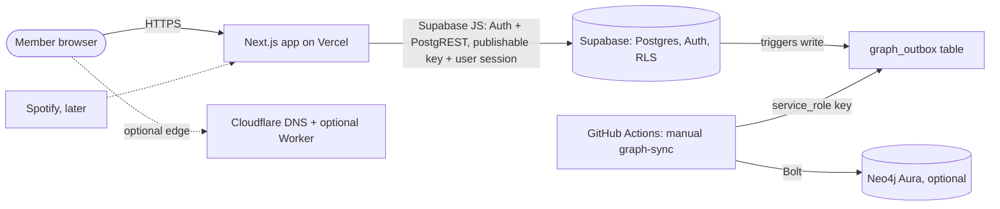

# Architecture

This document describes TBellini as it is and as it will be after Phase 1. The database already uses the
shared-space model; the TypeScript code in `src/` still uses the old community model until Phase 1 step b.
Every statement carries one of three labels:

- **[DB]** implemented in `supabase/migrations/` (through `20261017000000_shared_space.sql`).
- **[code]** implemented in `src/`, `scripts/`, `cloudflare/` or `.github/`.
- **[planned]** not implemented yet.

Read the migrations, not memory, when in doubt: they are the source of truth for data and access rules.

## 1. Product model

- **[DB]** One shared group. There is no community, membership or per-person privacy. A `profiles` row means
  "can log in". Every signed-in user with a profile reads everything; only a record's creator edits or deletes it
  (`supabase/migrations/20261017000000_shared_space.sql:3-5`, `:252-271`).
- **[DB]** Signup is invite-only (`20261006000003_invitations.sql`, `join_tbellini()` redefined in the shared-space
  migration at `:136-166`). Any member can create an invite; there is no admin role (`create_invitation`, `:169-203`).
- **[DB]** RSVPs are self-only. Tags point at a Person and never imply an RSVP (`:84-85`, `:265-268`).
- **[planned]** UI nuance: members should have to make an effort to look up another member's details unless they
  were posted. This is a UI concern (Phase 1 step d), not an RLS restriction.

## 2. System context



Hosting status:

| Component | Role | Status |
| --- | --- | --- |
| Next.js 16 app (`package.json`: `next` 16.3.8) | UI; single client component tree, one API route | [code] runs locally; **not deployed** |
| Vercel | Hosts the app | [planned] no project exists yet (Phase 2) |
| Supabase | Postgres, Auth, RLS: the source of truth | [DB] migrations and pgTAP tests exist; **no hosted project exists** (Phase 2) |
| Cloudflare | DNS (later) and an optional Worker `cloudflare/worker.js` that only serves `GET /health`; deployed by a manual workflow gated on `vars.CLOUDFLARE_DEPLOY_ENABLED` (`.github/workflows/cloudflare.yml`) | [code] worker and workflow; nothing deployed |
| Neo4j Aura | Optional derived graph, replayed from the outbox | [code] projector and manual workflow gated on `vars.NEO4J_SYNC_ENABLED` (`.github/workflows/graph-sync.yml`); no instance |
| Spotify | Music integration | [planned] (M2a); no code |
| Media storage (R2) | `MediaStorage` port only | [planned] (M2b); the port in `src/domain/ports.ts:2` has no implementation |

## 3. Repository layout

| Path | Contents |
| --- | --- |
| `src/app/` | Next.js App Router: `layout.tsx`, `page.tsx`, `error.tsx`, `api/health/route.ts` |
| `src/components/` | React UI (`archive-app.tsx`, `auth.tsx`, `calendar.tsx`, `forms.tsx`, `event-detail.tsx`, `community-views.tsx`) |
| `src/domain/` | `archive.ts` (entities, schemas, `ArchiveService`), `community.ts`, `ports.ts`, `time.ts` |
| `src/infrastructure/` | Adapters: `demo.ts`, `demo-store.ts`, `supabase.ts`, `supabase-community.ts`, `read-all.ts` |
| `src/lib/` | `archive-config.ts` (run-mode resolution), `latest-request.ts` |
| `supabase/migrations/`, `supabase/tests/` | Schema, RLS, functions; pgTAP tests |
| `scripts/` | Outbox replay and graph projection (`sync-graph.mjs`, `replay-outbox.mjs`, `project-graph.mjs`) |
| `neo4j/constraints.cypher`, `cloudflare/` | Graph constraint; optional edge worker |
| `tests/` | Vitest suites |

## 4. Layering

### Target state (after Phase 1) [planned]

```
components (UI)  ->  composition root  ->  ArchiveService (domain)  ->  ports
                          |                                              ^
                          +-> demo adapters | supabase adapters  --------+
                          +-> config (archive-config)
```

- Domain is pure: entities, zod schemas, time rules and `ArchiveService`, with no framework, storage or network imports.
- Ports are interfaces the domain depends on: repositories for events, people, tags and RSVPs, plus an `AuthPort`
  (so UI and service code stop using the concrete `SupabaseClient`).
- Two adapter sets implement the ports: demo (localStorage) and Supabase. They must behave the same.
- A composition root picks the adapter set from configuration and builds the `ArchiveService`. Components receive
  the service and never read `process.env` or import adapters.
- Phase 1 step b also introduces the demo snapshot v3 (migration from v2), shared Persons and `event_person_tags`.

### Current state [code]

- The domain is mostly pure: `src/domain/archive.ts` imports only `zod` and `community.ts`; `time.ts` has no imports of note.
  `ArchiveService` (`archive.ts:50`) enforces invariants over `ArchiveRepositories` (`archive.ts:25`).
- `src/domain/ports.ts` declares `MediaStorage` and `GraphProjection`. Both are unused (no implementation or consumer).
  Repository interfaces live in `archive.ts` and `community.ts`, not in `ports.ts`.
- Adapters: `createDemoRepositories` (`src/infrastructure/demo.ts:29`, backed by `DemoStore` in `demo-store.ts`) and
  `createSupabaseRepositories` (`src/infrastructure/supabase.ts:29`, plus `createCommunityRepository` in `supabase-community.ts:11`).
- **There is no composition root.** `src/components/archive-app.tsx` imports both adapters, reads
  `process.env.NEXT_PUBLIC_*` (line 30), and constructs `new ArchiveService(...)` in several places
  (demo at ~line 42, Supabase at ~line 53, demo reset at ~line 85). `components/auth.tsx` and `archive-app.tsx` use the
  concrete `SupabaseClient`; there is no `AuthPort`.
- Config: `archiveConfiguration()` (`src/lib/archive-config.ts:4`) is pure and is called from both `archive-app.tsx` and
  `src/app/api/health/route.ts`.
- **[code, stale against DB]** The domain still models `Community`, `ArchiveEvent.communityId/visibility`,
  private `Person` (`visibility: 'private'`), `Attendance` (private person links) and `UserTag`
  (`src/domain/archive.ts:10-12`, `src/domain/community.ts:2-7`). The Supabase adapter queries `event_people`,
  `event_user_tags`, `memberships` and sends `owner_id` for people (`supabase.ts:35`, `supabase-community.ts:14,20`,
  `supabase.ts:13`). Those tables and columns were removed or renamed by the shared-space migration, so **Supabase
  mode in code does not work against the current migrations** until step b. Demo mode is unaffected.

## 5. Data model [DB]

Authoritative: the migrations in order `20261006000000_archive.sql`, `…01_graph_lock.sql`, `…02_community.sql`,
`…03_invitations.sql`, `20261017000000_shared_space.sql`. The last is forward-only; earlier files still show the old model.

| Table | Key columns (after shared-space) | Notes |
| --- | --- | --- |
| `profiles` | `id` (= `auth.users.id`), `display_name`, timestamps | Created by the signup trigger. Presence means "can log in" (`has_profile()`, shared_space `:8-12`). Identity immutable (`…02:44-50`) |
| `events` | `id`, `owner_id` (creator, -> `auth.users`), `title` (1-200), `description`, `starts_at`, `ends_at`, `timezone` (validated), `location`, `provenance` (`manual`), timestamps | `community_id` and `visibility` dropped (`:120-123`). Identity and creator immutable (`:124-131`). Note the naming: events use `owner_id`, people use `created_by` |
| `people` | `id`, `display_name`, `notes`, `created_by` (-> `profiles`, nullable on profile delete), `member_id` (unique -> `profiles`), `provenance`, timestamps | The shared Person. People without accounts are Persons with null `member_id`. `owner_id` and `visibility` dropped (`:51-58`). Creator can become null, never be reassigned (`prevent_person_transfer`, `:60-69`) |
| `event_person_tags` | PK (`event_id`, `person_id`), `tagged_by`, `created_at` | Replaces `event_people` and `event_user_tags` (data converted, old tables dropped, `:84-103`). A tag never implies an RSVP |
| `event_rsvps` | PK (`event_id`, `user_id`), `status` (`going` or `interested`), timestamps | `community_id` dropped (`:105-110`). Identity immutable (`prevent_connection_transfer`, `:111-118`) |
| `invitations` | `code` (`^[A-Z0-9-]{8,12}$`), `created_by`, `expires_at`, `used_at`, `used_by`, `person_id` | No client access at all (`…03:13-15`). `person_id` added at shared_space `:134` |
| `person_claims` | PK (`person_id`, `claimant_id`), `claimant_id` unique | Claiming path 2, schema only (`:206-211`); no client UI |
| `graph_outbox` | `id`, `owner_id`, `aggregate_type`, `aggregate_id`, `operation`, `payload`, `created_at`, `processed_at` | Service role only. Types allowed: `event, person, attendance, profile, user_tag, rsvp, tag` (`:16-18`); `attendance` and `user_tag` are retired but still permitted |
| `graph_sync_lock` | single-lock table | Service role only (`…01:3-9`) |

Removed by the shared-space migration: `communities`, `memberships`, `event_people`, `event_user_tags`, `is_community_member()` (`:102-103`, `:237-239`).

Functions (all `set search_path = ''`):

- `has_profile()`: used by every RLS policy.
- `join_tbellini()`: after-insert trigger on `auth.users` (`auth_join_tbellini`, `…02:21`).
- `create_invitation(expires_in_days default 7, for_person default null)`: executable by `authenticated` only.
- `ensure_member_person(uuid)`: service role only; every member gets a Person (default; the body is the one place to change this).
- `confirm_person_claim(claimed_person, claimant)`: creator of an unlinked Person confirms and merges.
- `enqueue_graph_change()`, `touch_updated_at()`, `prevent_*_transfer()`: triggers.
- `acquire_graph_sync_lock(uuid)`, `release_graph_sync_lock(uuid)`: service role only.

## 6. Auth, RLS and invite flow

### Row-level security [DB]

All policies are `to authenticated`, so `anon` reads nothing. See `shared_space.sql:252-271`.

| Table | Read | Insert | Update / delete |
| --- | --- | --- | --- |
| `profiles` | any profile holder | none (trigger only) | none (no policy) |
| `events` | any profile holder | `owner_id = auth.uid()` | creator only |
| `people` | any profile holder | `created_by = auth.uid()` | creator only; clients may update only `display_name`, `notes` (`:243-245`); `member_id` is never client-writable |
| `event_person_tags` | any profile holder | `tagged_by = auth.uid()` **and** caller owns the event | delete by `tagged_by`; no update grant |
| `event_rsvps` | any profile holder | own `user_id` | own `user_id` |
| `person_claims` | any profile holder | own claim on an unlinked Person | claimant or the Person's creator may delete |

Access is verified by pgTAP: `supabase/tests/archive_rls.sql`, `community_rls.sql`, `invitations_rls.sql`
(67/67 passing per the project context; run by the `database` job in `.github/workflows/ci.yml`).
The three test files predate the rename but run against the migrated schema.

### Invite flow

1. [DB] A member calls RPC `create_invitation` (code format `XXXX-XXXX`, alphabet without ambiguous characters, 1-30 days,
   optionally naming an unlinked Person to claim).
2. [code] `src/components/auth.tsx` calls `supabase.auth.signUp` with `invite_code` and `display_name` in user metadata (`auth.tsx:29-34`), and
   `signInWithPassword` for login (`:46`). The code calls `create_invitation` from `supabase-community.ts:31`.
3. [DB] The `auth.users` insert trigger `join_tbellini()` atomically marks the invite used; an invalid, used or expired
   code raises and the signup fails. It then creates the profile and links the named Person (or creates a new one).
4. [planned] Hosted Auth settings (email confirmation, site URL, redirect URLs) are unconfigured and unverified. A first-invite
   seed script is also planned (the first user cannot sign up without an invite).

There is no server-side session handling: the browser client (`createArchiveClient`, `supabase.ts:8`, `@supabase/ssr`
`createBrowserClient`) holds the session, and there is no middleware or server component auth. [code]

## 7. Outbox to graph flow

1. [DB] Row triggers on `events`, `people`, `profiles`, `event_person_tags` and `event_rsvps` call `enqueue_graph_change()`
   (`shared_space.sql:19-30`, `:95`; `…02:129-131`), inserting into `graph_outbox` in the same transaction as the change.
2. [code] `scripts/sync-graph.mjs` (run manually via the `Replay archive graph` workflow, `workflow_dispatch` only) uses the
   service role key to take `acquire_graph_sync_lock`, read up to 100 pending rows in `id` order, project each into Neo4j
   (`scripts/project-graph.mjs`), set `processed_at`, then release the lock. `scripts/replay-outbox.mjs` holds the replay loop.
3. Neo4j is a replayable projection. Postgres stays authoritative; the app never reads Neo4j.
4. **[code, stale]** The projector still maps only `event`, `person`, `profile`, `attendance`, `user_tag`, `rsvp` and scopes by
   `community_id` (`project-graph.mjs:6-27`). It does not handle the new `tag` type and will throw `Unsupported graph aggregate type`
   if a `tag` row is replayed. **[planned]** Phase 1 step c (deferrable past go-live because Neo4j is optional).

## 8. Run modes and environment variables

`NEXT_PUBLIC_ARCHIVE_MODE` selects the mode (`src/lib/archive-config.ts:5-11`):

| Value | Behaviour [code] |
| --- | --- |
| `demo` | Data in browser `localStorage` (key `tbellini.community.v2`, `demo-store.ts:5`), two seeded demo users, no network |
| `supabase` | Real mode. Requires URL and publishable key, valid http(s) URL; otherwise a configuration error |
| unset | `demo` when `NODE_ENV` is not `production`; `unconfigured` error in production |
| anything else | `unconfigured` error |

`GET /api/health` reports `ok` or `configuration_required` from configuration only; it does not contact Supabase
(`src/app/api/health/route.ts:2`). **[planned]** Extend it to ping Supabase in Phase 2.

| Variable | Used by | Notes |
| --- | --- | --- |
| `NEXT_PUBLIC_ARCHIVE_MODE` | app, health route | Build-time, browser-visible. Rebuild after changing |
| `NEXT_PUBLIC_SUPABASE_URL` | app, health route, `sync-graph.mjs` | Public |
| `NEXT_PUBLIC_SUPABASE_PUBLISHABLE_KEY` | app, health route | Public; RLS and the user session enforce access |
| `SUPABASE_SERVICE_ROLE_KEY` | `sync-graph.mjs` only | Secret; never `NEXT_PUBLIC_`, never on Vercel |
| `NEO4J_URI`, `NEO4J_USERNAME`, `NEO4J_PASSWORD`, `NEO4J_DATABASE` | `sync-graph.mjs` only | Secrets (database defaults to `neo4j`) |

Template: `.env.example`. In the graph workflow the URL comes from `vars.SUPABASE_URL` and the secrets from GitHub
`production` environment secrets.

Local verification commands (`package.json`): `npm run lint`, `typecheck`, `test` (vitest plus node tests for graph scripts and
the worker), `build`; the `database` CI job runs `supabase db reset` and `supabase test db`.

## 9. Known architectural debt

All [code] unless noted; fixes are scheduled for Phase 1 step b.

- No composition root; `archive-app.tsx` owns adapter selection, env reads and service construction (see section 4).
- No `AuthPort`; `auth.tsx` and `archive-app.tsx` depend on the concrete `SupabaseClient`.
- `MediaStorage` and `GraphProjection` in `ports.ts` are unused.
- Very long lines in source (for example `src/infrastructure/demo-store.ts:19`, about 983 characters).
- Tag and RSVP guards are duplicated between the demo and Supabase community adapters, and adapter behavioural parity is unverified.
- Naming inconsistency: `events.owner_id` versus `people.created_by` [DB]; step b may rename.
- The outbox check constraint still permits retired types `attendance` and `user_tag` [DB]; step c retires them.
- The data-migrating paths of the shared-space migration (Person backfill, conversion of `event_people` and `event_user_tags`)
  were never tested on a non-empty database [DB].
- Real-mode flows have never run against a hosted Supabase project.
